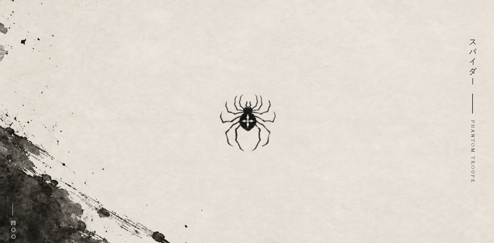
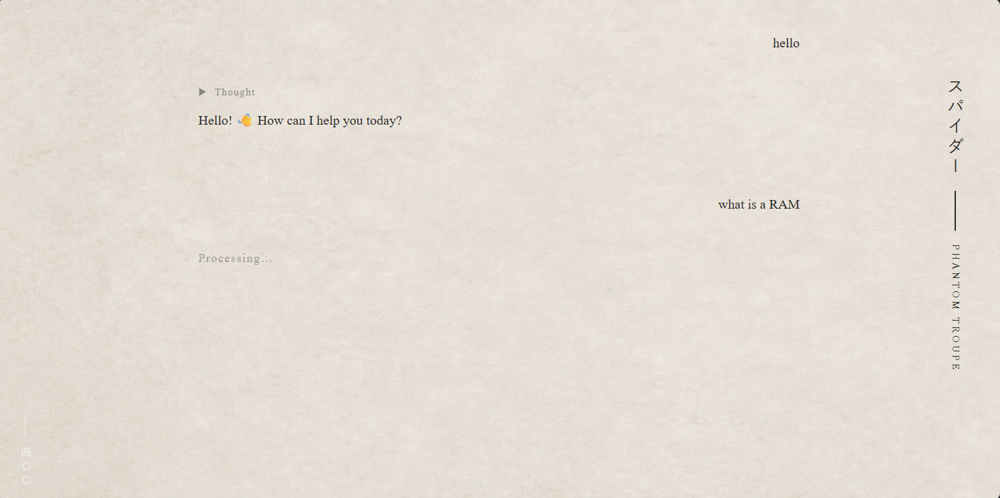

[](https://github.com/Amen974/kai/actions/workflows/cargo-test.yml)

# kai

A local-first desktop AI chat application that streams responses from a locally running Ollama server and stores conversations in SQLite.




## Features

- Streaming chat with Ollama, including separate rendering of model "thinking" output.
- Message editing that forks a new branch and regenerates the response, with a branch navigator to switch between variants.
- Resend the last response and cancel an in-flight generation.
- Conversation history with server-side SQLite FTS5 search over titles and user messages.
- Model catalog synced from Ollama (`/api/tags` and `/api/show`), cached in SQLite, with per-model family, parameter size, quantization, disk size and vision support.
- Model picker and model download panel with live pull progress.
- Assistant messages rendered as Markdown with syntax highlighting, copy support and collapsible thinking blocks.
- Conversation titles generated automatically after the first message.
- Session recovery on launch and persisted branch selection.
- Keyboard-driven UI with a frameless window.

## Tech stack

| Layer | Technology |
| --- | --- |
| UI | React 19.1, TypeScript 6.0, Tailwind CSS 4.3, Zustand 5.0 |
| Build | Vite 8.0, `@vitejs/plugin-react` 6.0 |
| Desktop shell | Tauri 2 (`@tauri-apps/api` 2, `@tauri-apps/cli` 2) |
| Backend | Rust (edition 2021), tokio, reqwest, thiserror |
| Storage | SQLite via `rusqlite` 0.40 (bundled) with `rusqlite_migration` 2.6 |
| Markdown | `react-markdown` 10.1, `remark-gfm`, `rehype-highlight` + `highlight.js` 11 |
| LLM runtime | Ollama at `http://localhost:11434` |

## Getting started

### Prerequisites

- Node.js and npm.
- A Rust toolchain, plus the system dependencies required by Tauri 2 for your platform.
- [Ollama](https://ollama.com) running locally on port `11434`, with at least one model pulled (for example `ollama pull qwen3:4b`).

### Install and run

```bash
git clone https://github.com/Amen974/kai.git
cd kai
npm install
npm run tauri dev
```

The Vite dev server runs on port `1420` and is started automatically by `tauri dev`. Running `npm run dev` alone serves only the frontend, so Tauri commands are unavailable in that mode.

### Environment variables

None. The Ollama base URL is fixed in `src-tauri/src/ollama.rs`, and the app needs no configuration file.

## Tests

Backend unit tests live in `src-tauri/` and run without Ollama:

```bash
cd src-tauri
cargo test --lib
```

## Available scripts

| Script | Description |
| --- | --- |
| `npm run dev` | Start the Vite dev server on port 1420 (frontend only). |
| `npm run build` | Typecheck with `tsc` and build the production frontend bundle with Vite. |
| `npm run tauri dev` | Run the desktop app (starts the Vite dev server through Tauri). |

## Project structure

```text
src/           React frontend: components, pages, Zustand stores, keymap, Tauri event listener
src-tauri/     Rust backend: Tauri commands, services (chat, models, attachments), Ollama client, SQLite repository and migrations
public/        Static assets (logo and background images)
index.html     Vite entry HTML
vite.config.ts Vite config with the fixed dev port used by Tauri
```

## Author

Amen Allah Arfaoui — [github.com/Amen974](https://github.com/Amen974)
